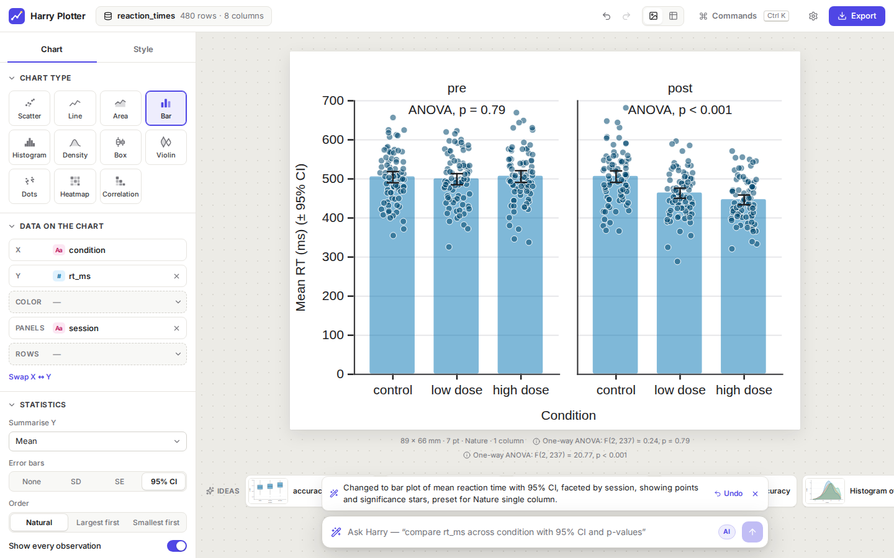
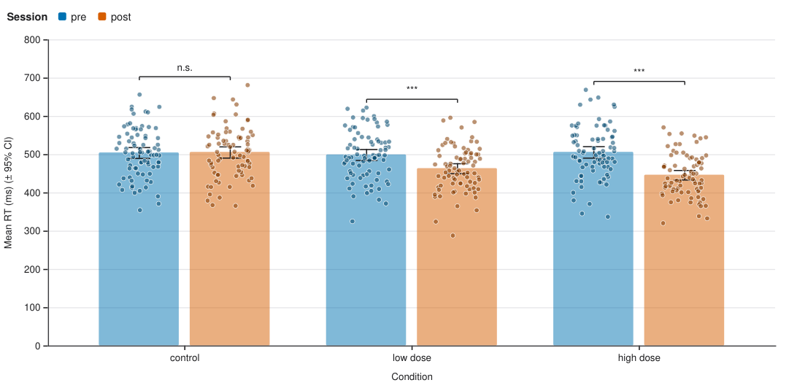
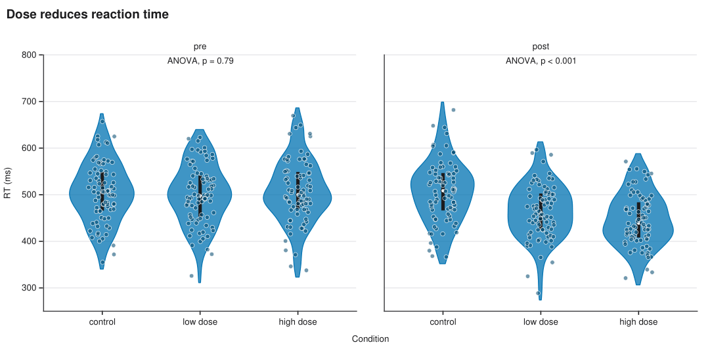
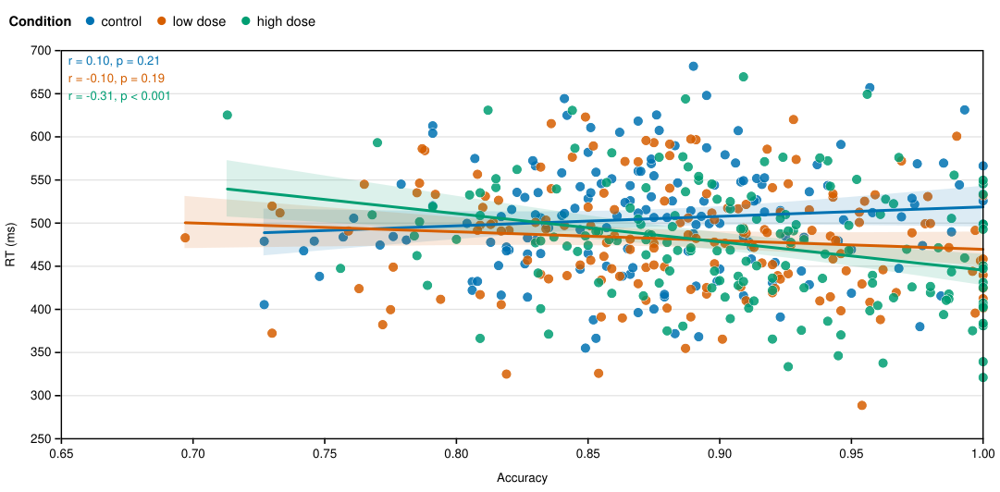

# Harry Plotter

**Publication-ready scientific figures in seconds — no code, no fighting with matplotlib.**

Drop a CSV or Excel file and you get a sensible, good-looking figure immediately.
Refine it with plain controls, with ⌘K, or by asking in plain language. Export a
vector PDF at the exact size your journal wants, or take the figure with you as
Python or R code.



## Why researchers like it

- **Instant first figure.** Harry reads your columns (numbers, dates, groups, units)
  and proposes the charts worth looking at first. It picks the measure that differs
  most between your groups and the strongest correlation.
- **Statistics where you need them.** Mean ± SD / SE / 95% CI, regression with
  confidence band, LOESS, Pearson r and p, Welch t-test brackets with stars, one-way
  ANOVA, raw points over bars, boxes and violins. Every value is checked against scipy
  in the test suite.
- **Journal-exact output.** Presets for Nature, Science, Cell, IEEE, PLOS, thesis,
  slides and posters set the physical size in mm and the font size in pt. PDF and SVG
  are vector; PNG and TIFF carry the right DPI (150–1200). What you see is the size you
  submit.
- **Reproducible.** Every figure exports as a runnable **Python (seaborn/matplotlib)**
  or **R (ggplot2)** script, or as a `.hplot.json` project with the data inside.
- **AI when you want it, never required.** Ask “compare reaction time across doses with
  95% CI and p-values, Nature single column” and it happens. The AI only edits the
  figure description (no generated code runs), and every change can be undone. Without
  a key, short phrases still work offline (“log y”, “color by group”, “violin”,
  “bianco e nero”), as does the ⌘K command palette.
- **Your data stays on your computer.** Everything runs in the browser. The optional
  local server only proxies AI requests.
- **Improve this plot.** One click measures the real layout and fixes what annoys
  reviewers: overlapping tick labels, crowded legends, overplotting, bad bin counts,
  skewed axes, text below 6 pt. With AI on, a vision model then looks at the rendered
  figure and polishes what is left. Everything can be undone.
- **Ideas from your data.** Harry reads a statistical summary of your dataset (types,
  ranges, group sizes, correlations; never the raw rows) and proposes figures, each one
  tied to a concrete research question.
- **Edit on the figure.** Double-click the title, an axis label or the legend title to rewrite it in place.
- **Paste from Excel.** Copy cells, press ⌘V, done.

| | | |
|---|---|---|
|  |  |  |

## Use it

**From Python / Jupyter**

```bash
pip install git+https://github.com/alessiogandelli/harryplotter
```

```python
import harryplotter as hp
hp.plot(df)               # a pandas DataFrame: the editor opens inside the notebook
hp.plot("results.xlsx")   # or a file
```

**From a terminal**

```bash
harryplotter results.csv
```

**AI (optional).** Set one of these before starting and the key stays on the server:

```bash
export OPENROUTER_API_KEY=...        # or OPENAI_API_KEY=...
export HARRYPLOTTER_MODEL=deepseek/deepseek-v4.1-flash   # the default; any vision-capable model works
# any OpenAI-compatible endpoint, e.g. a local Ollama:
export HARRYPLOTTER_BASE_URL=http://localhost:11434/v1 HARRYPLOTTER_API_KEY=ollama HARRYPLOTTER_MODEL=qwen2.5:7b
```

**What it costs.** Measured with real calls on the example dataset (OpenRouter prices, Oct 2026):

| action | tokens in / out | gpt-4.1-mini | deepseek-v4.1-flash (default) |
|---|---|---|---|
| edit by prompt | ~1.3k / 0.2–0.4k | $0.0008 | $0.0004 |
| improve (with image) | ~2k / 0.03–1.3k | $0.0009 | $0.0008 |
| ideas from data | ~1.5k / 0.6–1.6k | $0.0015 | $0.0009 |

That is roughly 1.5 cents for a long session with the default model (30 edits, 5 improves, 2 idea rounds), and the
deterministic half of Improve, ⌘K and the offline phrases cost nothing.

The editor also works as a plain static site (GitHub Pages, a file share). In that
case the AI key is entered in Settings and stays in the browser.

## Chart types

Scatter · Line · Area · Bar · Histogram · Density · Box · Violin · Dots (jitter +
mean ± CI) · Heatmap · Correlation matrix, all with colour groups, small multiples
(panels by column and/or row), filters, log/sqrt scales, reference lines, and
colour-blind-safe palettes (Okabe–Ito by default, plus NPG, Lancet, Tableau, viridis…).

## Develop

```
web/       the editor: React + TypeScript + Observable Plot (Vite)
  src/lib/   spec, rendering, stats, code export, AI, offline commands — UI-free and unit-tested
python/    the `harryplotter` package: stdlib-only server, CLI, `hp.plot()`; ships the built editor
samples/   generator for the example datasets
```

```bash
cd web && npm install
npm run dev            # editor at http://localhost:5173 (proxies /api to :8765)
npm test               # unit tests: stats vs scipy, labels, offline commands, code export
npm run build          # builds into python/harryplotter/static

cd .. && uv run --with pytest --with-editable . pytest   # server tests
HP_CODEGEN_OUT=/tmp/hp npm --prefix web test               # also writes every generated script, to run them
```

### How it works

One small JSON document, the **spec**, describes the figure: chart type, which
columns go where, statistics, style, size, filters. The UI, ⌘K, the offline phrase
parser and the AI all produce changes to that spec. Every change goes through the same
validation (`normalizeSpec`) and lands on the undo stack. The renderer turns the spec
into SVG with Observable Plot. The exporters turn the same spec into PDF/PNG/TIFF or
into Python and R code.
